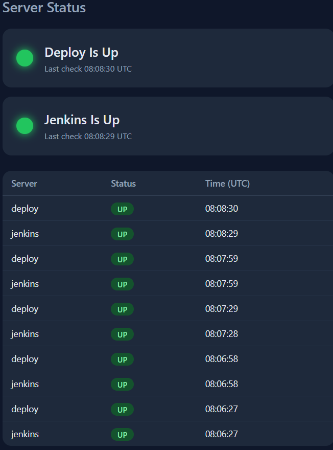

Server Status Dashboard
A small monitoring dashboard built with Python, Flask and PostgreSQL, running in Docker containers on AWS EC2. It checks my Jenkins server and a deploy agent every 30 seconds, saves each result in a database, and shows live UP/DOWN status on a web page.

How it works
1.  A background thread in the Python app checks each server's URL.
2.  Every result (name, up or down, time) is saved in a PostgreSQL table called checks.
3.  The Flask web page reads the latest results from the database and refreshes itself every 30 seconds.
The app and the database run as two containers on one custom Docker network. The app finds the database by its container name.
What the page shows
• One card per server, with a green or red dot
• A table of the last 10 checks
Tech
• Python 3.12 and Flask
• PostgreSQL 16
• Docker (custom network, containers, env file)
• Docker Compose (two services, volume, healthcheck)
• AWS EC2 (security groups, VPCs)
Run it
Create the network and the database:
docker network create my-net
docker run -d --name postgres --network my-net \
  -e POSTGRES_USER=dash -e POSTGRES_PASSWORD=your-password -e POSTGRES_DB=status_db \
  postgres:16
Build the app image:
docker build -t status-app .
Create a settings file, for example status-app.env, outside the repo:
DB_PASSWORD=your-password
TARGETS=jenkins=http://JENKINS_ADDRESS:8080/login,deploy=http://AGENT_ADDRESS:8000/
Start the app:
docker run -d --name status-app --network my-net -p 8000:8000 --env-file status-app.env status-app
Open http://SERVER_IP:8000 in a browser.
Run it with Docker Compose
Compose starts the app and the database together with one command.
1.  Create the settings file status-app.env outside the repo (same as above).
2.  In the project folder, make a .env link to it: ln -s ~/status-app.env .env (.env is in .gitignore, so the password never reaches GitHub).
3.  Start everything:
docker compose up -d
4.  After changing the code, rebuild with:
docker compose up -d --build
5.  Stop everything:
docker compose down
What the compose file does:
• Two services: postgres and app. The app reaches the database by the service name postgres.
• A volume called pgdata keeps the check history, so the data survives docker compose down. Only docker compose down -v deletes it.
• Postgres has a healthcheck (pg_isready, every 5 seconds, timeout 3 seconds, 5 retries).
• The app uses depends_on with condition: service_healthy, so it starts only after the database is ready.
• restart: unless-stopped brings the containers back after a reboot.
Settings
• DB_PASSWORD: the database password (required)
• TARGETS: servers to check, written as name=url,name=url
• DB_HOST: database container name (default postgres)
• INTERVAL: seconds between checks (default 30)
What I learned
• Private IPs only work inside one VPC. Two machines in different VPCs need public IPs or VPC peering.
• A connection timeout means a firewall or network block. "Connection refused" means the machine answered but nothing was listening.
• Keep passwords out of code. Use an env file and a .gitignore.
• depends_on alone only controls start order. A healthcheck with service_healthy makes the app wait until Postgres is really ready.
• docker compose down removes containers and the network, but keeps the volume and the images.
Next ideas
• Check more servers and show a history chart
• Alerts when a server goes down
• Run the whole stack on a server built with Terraform (done in a separate project)
