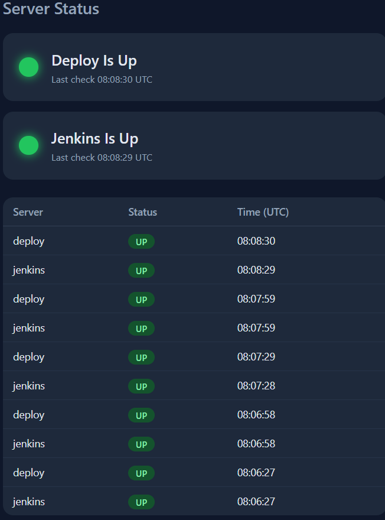

# Server Status Dashboard

A small monitoring dashboard built with Python, Flask and PostgreSQL, running in Docker containers on AWS EC2.

It checks my Jenkins server and a deploy agent every 30 seconds, saves each result in a database, and shows live UP/DOWN status on a web page.

## How it works

1. A background thread in the Python app checks each server's URL.
2. Every result (name, up or down, time) is saved in a PostgreSQL table called `checks`.
3. The Flask web page reads the latest results from the database and refreshes itself every 30 seconds.

The app and the database run as two containers on one custom Docker network. The app finds the database by its container name.

## What the page shows

- One card per server, with a green or red dot
- A table of the last 10 checks

## Tech

- Python 3.12 and Flask
- PostgreSQL 16
- Docker (custom network, containers, env file)
- AWS EC2 (security groups, VPCs)

## Run it

Create the network and the database:

    docker network create my-net
    docker run -d --name postgres --network my-net \
      -e POSTGRES_USER=dash -e POSTGRES_PASSWORD=your-password -e POSTGRES_DB=status_db \
      postgres:16

Build the app image:

    docker build -t status-app .

Create a settings file, for example `status-app.env`, outside the repo:

    DB_PASSWORD=your-password
    TARGETS=jenkins=http://JENKINS_ADDRESS:8080/login,deploy=http://AGENT_ADDRESS:8000/

Start the app:

    docker run -d --name status-app --network my-net -p 8000:8000 --env-file status-app.env status-app

Open `http://SERVER_IP:8000` in a browser.

## Settings

- `DB_PASSWORD`: the database password (required)
- `TARGETS`: servers to check, written as `name=url,name=url`
- `DB_HOST`: database container name (default `postgres`)
- `INTERVAL`: seconds between checks (default 30)

## What I learned

- Private IPs only work inside one VPC. Two machines in different VPCs need public IPs or VPC peering.
- A connection timeout means a firewall or network block. "Connection refused" means the machine answered but nothing was listening.
- Keep passwords out of code. Use an env file and a `.gitignore`.

## Next ideas

- Check more servers and show a history chart
- Alerts when a server goes down
- Docker Compose to start everything with one command
